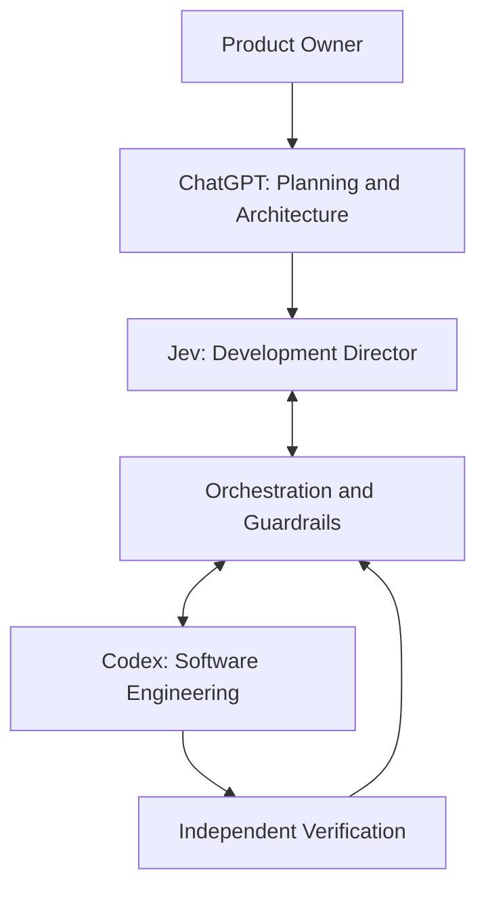

# FliHub-3

FliHub is a multi-tenant platform for managing sports organizations, leagues, events, fantasy competitions, sponsorships and charity events.

## Platform

- Organization management, membership and role-based permissions.
- Leagues, seasons, teams, athletes and event scheduling.
- Mobile scorekeeping, official results, standings and public pages.
- Fantasy leagues, live drafts and competition results.
- Sponsorship quotes, agreements, payments and funding conditions.
- Expenses, reimbursements and receipt management.
- Charity organization and participant management (in development).

## Technology

| Layer                   | Technology                  |
| ----------------------- | --------------------------- |
| Frontend                | SvelteKit, TypeScript       |
| UI                      | Tailwind CSS, shadcn-svelte |
| Backend and database    | PocketBase                  |
| Development email       | Mailpit                     |
| Intelligence            | Jev by TypeSafe AI          |
| AI engineering          | OpenAI Codex                |
| Development environment | GitHub Codespaces           |

## Getting started

Use Node.js 24 and compatible PocketBase and Mailpit binaries in `pocketbase/`. Configure the local environment using `.env.example` as a reference.

```bash
npm ci
npm run dev:all
```

| Command               | Purpose                                  |
| --------------------- | ---------------------------------------- |
| `npm run dev:all`     | Start or recognize local services        |
| `npm run dev:status`  | Check service and intelligence readiness |
| `npm run jev:develop` | Open the development director            |
| `npm run dev:stop`    | Stop managed development services        |

Local services: SvelteKit (`5173`), PocketBase (`8090`) and Mailpit (`8025`). Startup is manual and does not initiate AI requests or reset data.

Run `npm run jev:develop` from the FliHub repository root and choose **8**
for the offline Development Assignment Builder. Select a custom objective
or the registered roadmap milestone 3, then enter repository-relative
scope paths, exclusions, acceptance checks and verification. Commit and
push each default to excluded. Inspect the draft and enter `copy` to
present the reviewed text, `revise` to re-enter the inputs, or Enter to
cancel. Copy the reviewed text into a separately authorized manual Codex
session. The builder does not launch a worker, contact a provider or save
an assignment file.

The builder recognizes the configured FliHub GitHub origin and reports
local tracking comparisons. Live remote state is unverified. Governing
file discovery covers root and named scope ancestors without following
symlinks or reading file contents. Dirty file contents and submodule
worktree changes are outside the inspection. Full review and file export
remain milestone 3. See the [intelligence roadmap](docs/INTELLIGENCE-ROADMAP.md#adm-1-and-adm-2-local-checkpoint).

The development director also offers an offline isolated source exercise when the Linux Bubblewrap preflight passes. Use option 6 in `npm run jev:develop`. For its limits, authorization and review export, see the [intelligence architecture](docs/INTELLIGENCE-ARCHITECTURE.md#isolated-source-engineering-and-review).

## AI-directed development

FliHub is developing a reusable intelligence architecture that combines human direction, structured AI decisions and automated engineering.



Jev selects authorized development actions, Codex performs engineering tasks, and deterministic controls enforce permissions, scope, budgets and acceptance criteria. Humans retain final authority.

**Current status:** The repository owner accepted the offline FliHub tee-time pilot through option 7 in `npm run jev:develop`, including isolated verification and review-only patch export. The earlier live Jev exercise used Codex CLI against a synthetic endpoint. Authenticated Codex engineering and final AI-1F acceptance remain pending. The director defaults to offline operation. Live Jev use requires explicit authorization and a private `TYPESAFE_API_KEY`.

## Verification

```bash
npm run check
npm run lint
node --test --test-isolation=none tests/*.test.mjs
npm run test:integration
npm run build
```

## Documentation

- [Development instructions](AGENTS.md)
- [Intelligence roadmap](docs/INTELLIGENCE-ROADMAP.md)
- [Intelligence architecture](docs/INTELLIGENCE-ARCHITECTURE.md)
- [Intelligence provider notes](docs/INTELLIGENCE-PROVIDER-EVALUATION.md)
- [Charity event roadmap](docs/CHARITY-EVENT-ROADMAP.md)
- [Funding roadmap](docs/FUNDING-ROADMAP.md)

## Development principles

Security by design. Tenant isolation. Human authorization. Independent verification. Documented decisions. Incremental delivery.

For the proposed real-project pilot and pending authenticated dispatch requirements, see the [AI-1F authenticated engineering checkpoint](docs/INTELLIGENCE-ARCHITECTURE.md#ai-1f-authenticated-engineering-checkpoint).
