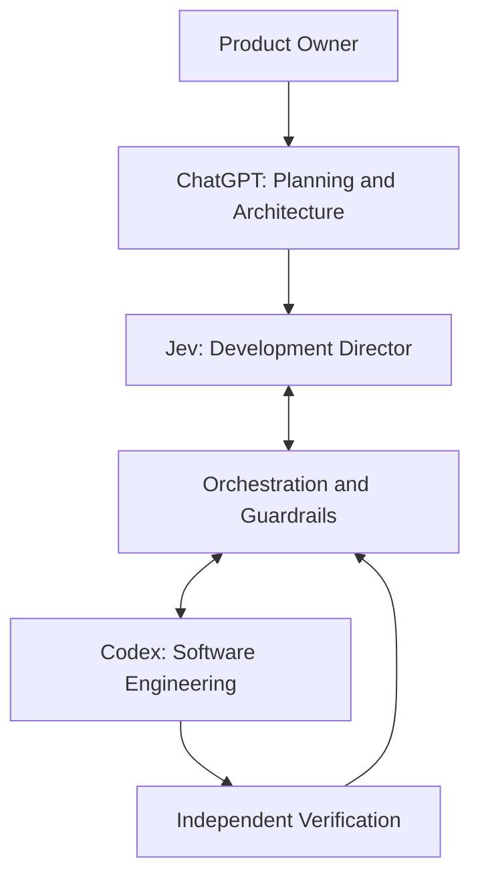

# FliHub-3

FliHub is a multi-tenant platform for managing sports organizations, leagues, events, fantasy competitions, sponsorships and charity events.

## Platform

- Organization management, membership and role-based permissions.
- Leagues, seasons, teams, athletes and event scheduling.
- Mobile scorekeeping, official results, standings and public pages.
- Fantasy leagues, live drafts and competition results.
- Sponsorship quotes, agreements, payments and funding conditions.
- Expenses, reimbursements and receipt management.
- Charity organization and participant management (in development).

## Technology

| Layer                   | Technology                  |
| ----------------------- | --------------------------- |
| Frontend                | SvelteKit, TypeScript       |
| UI                      | Tailwind CSS, shadcn-svelte |
| Backend and database    | PocketBase                  |
| Development email       | Mailpit                     |
| Intelligence            | Jev by TypeSafe AI          |
| AI engineering          | OpenAI Codex                |
| Development environment | GitHub Codespaces           |

## Getting started

Use Node.js 24 and compatible PocketBase and Mailpit binaries in `pocketbase/`. Configure the local environment using `.env.example` as a reference.

```bash
npm ci
npm run dev:all
```

| Command               | Purpose                                  |
| --------------------- | ---------------------------------------- |
| `npm run dev:all`     | Start or recognize local services        |
| `npm run dev:status`  | Check service and intelligence readiness |
| `npm run jev:develop` | Open the development director            |
| `npm run dev:stop`    | Stop managed development services        |

Local services: SvelteKit (`5173`), PocketBase (`8090`) and Mailpit (`8025`). Startup is manual and does not initiate AI requests or reset data.

Run `npm run jev:develop` from the FliHub repository root and choose **8**
for the offline Development Assignment Builder. Select a custom objective
or the registered roadmap milestone 3, then enter repository-relative
scope paths, exclusions, acceptance checks and verification. Commit and
push each default to excluded for a new draft. Inspect the complete draft,
then choose one of the following.

- Enter `revise` to edit the inputs. Enter at a field keeps its existing
  value. Git declarations can be explicitly changed with `yes` or `no`.
  Review the revised draft and approve it again before export.
- Enter `copy` to display the assignment for manual copy.
- To export, enter the displayed `approve <SHA-256>` command for the
  exact draft, then enter `export`. After checking the repository again,
  the builder writes a private `/tmp/flihub-development-assignment-<id>.txt`
  and displays its path and the `code` command. The filename is derived
  from the assignment. An existing file or symlink blocks export.
- Press Enter at either review prompt to cancel.

Use the reviewed text in a separately authorized manual Codex session.
The builder never launches a worker or contacts a provider.

The builder recognizes the configured FliHub GitHub origin and reports
local tracking comparisons. Live remote state is unverified. Governing
file discovery covers root and named scope ancestors without following
symlinks or reading file contents. Dirty file contents and submodule
worktree changes are outside the inspection. See the
[intelligence roadmap](docs/INTELLIGENCE-ROADMAP.md#adm-3-local-checkpoint).

### Import an offline completion report

Save the report at the exact path specified by the assignment,
`/tmp/flihub-development-assignment-<id>-report.txt`. Keep its matching
assignment export in `/tmp`. Open `npm run jev:develop`, choose **9**, and
enter the assignment ID. Review the reported outcomes and missing fields,
then enter `import` to confirm or press Enter to cancel.

Use UTF-8 source text and the following header. Substitute the assignment
identifier and full Git commits. Use `unknown` for an unavailable ending
checkpoint. Keep the blank line after the header.

```text
# FliHub completion report
Report format version: 1
Assignment ID: <20 lowercase hex characters>
Assignment format version: 1
Starting checkpoint: <40 lowercase hex characters>
Ending checkpoint: unknown

## Completed work
Describe the work completed.
```

The supported sections are Changed files, Completed work, Incomplete work,
Verification, Blockers, Git status, Security outcomes, and Remaining work.
Use at least one `##` section. Omitted and empty sections display as missing.
The earlier ADM-3 report layout is also supported when its matching export
is available.

Each input is limited to 64 KiB and must be an operator-owned regular file
with one link. Exclude credentials and private payloads before confirming.
Records retain original report bytes, SHA-256 digests, source path,
timestamp, assignment reference, and unverified outcomes. They are private
JSON files under `/tmp/flihub-completion-reports-<uid>/`. The same assignment
and report digest cannot be imported twice. Different report bytes create
separate records. Temporary storage may be cleared by the system.

### Assess completion evidence offline

In `npm run jev:develop`, choose **10**. Supply the assignment ID,
the approved assignment SHA-256, and the imported report SHA-256.
The console checks the fixed local export, report, and retained import
record against those digests and the original embedded report bytes.

The assessment verifies locally available commit objects, ancestry, the
net changed paths, and the report's exact bullet-list inventory. Scope
covers named paths and descendants of directories present at the starting
commit. A new path is matched exactly. The current worktree and tracking
ref are observations made during assessment. Historical Git claims and
live remote state are unverified. The diff excludes transient changes
reverted between commits and does not interpret prose exclusions.

Check the findings and enter an optional human observation. The prompt
shows an exact `accept <SHA-256>` command to record acknowledgment of
this assessment. Enter cancels. Acknowledgment does not determine
completion or grant execution or publication authority. Worker claims,
missing evidence, scope violations and contradictory inventory remain
visible. Test results and execution claims require evidence outside
this Git-only assessment and are never accepted from report text.

A recorded review is a private, versioned JSON file under
`/tmp/flihub-evidence-assessments-<uid>/`. Identical reviews cannot
overwrite prior records. The console rechecks evidence and context
before saving. Temporary storage may be cleared by the system.

The development director also offers an offline isolated source exercise when the Linux Bubblewrap preflight passes. Use option 6 in `npm run jev:develop`. For its limits, authorization and review export, see the [intelligence architecture](docs/INTELLIGENCE-ARCHITECTURE.md#isolated-source-engineering-and-review).

## AI-directed development

FliHub is developing a reusable intelligence architecture that combines human direction, structured AI decisions and automated engineering.



Jev selects authorized development actions, Codex performs engineering tasks, and deterministic controls enforce permissions, scope, budgets and acceptance criteria. Humans retain final authority.

**Current status:** The repository owner accepted the offline FliHub tee-time pilot through option 7 in `npm run jev:develop`, including isolated verification and review-only patch export. The earlier live Jev exercise used Codex CLI against a synthetic endpoint. Authenticated Codex engineering and final AI-1F acceptance remain pending. The director defaults to offline operation. Live Jev use requires explicit authorization and a private `TYPESAFE_API_KEY`.

## Verification

```bash
npm run check
npm run lint
node --test --test-isolation=none tests/*.test.mjs
npm run test:integration
npm run build
```

## Documentation

- [Development instructions](AGENTS.md)
- [Intelligence roadmap](docs/INTELLIGENCE-ROADMAP.md)
- [Intelligence architecture](docs/INTELLIGENCE-ARCHITECTURE.md)
- [Intelligence provider notes](docs/INTELLIGENCE-PROVIDER-EVALUATION.md)
- [Charity event roadmap](docs/CHARITY-EVENT-ROADMAP.md)
- [Funding roadmap](docs/FUNDING-ROADMAP.md)

## Development principles

Security by design. Tenant isolation. Human authorization. Independent verification. Documented decisions. Incremental delivery.

For the proposed real-project pilot and pending authenticated dispatch requirements, see the [AI-1F authenticated engineering checkpoint](docs/INTELLIGENCE-ARCHITECTURE.md#ai-1f-authenticated-engineering-checkpoint).
